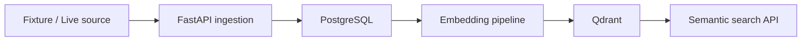

# Semantic Job Search API

## Overview

Semantic Job Search API is a FastAPI backend for loading job vacancies, normalizing them into PostgreSQL, generating embeddings, indexing them in Qdrant, and exposing semantic search with metadata filters.

The project supports two source modes:
- `fixture`: imports realistic fictional vacancies for local demos and CI.
- `live`: fetches matching vacancies from Work.ua when external access is available.

## Architecture



## Project names

- Application title: `Semantic Job Search API`
- Project slug: `semantic_job_search`
- PostgreSQL database: `semantic_jobs`
- PostgreSQL user: `semantic_jobs_app`
- Qdrant collection: `job_vacancies`

## Quick Start

Prepare local configuration:

```bash
cp .env.example .env
```

Before running the stack, replace this placeholder in `.env` with your own local value:

```env
ADMIN_API_KEY=change_me
```

Start services and apply migrations:

```bash
docker compose up -d --build
docker compose exec api alembic upgrade head
curl http://localhost:8000/health
```

API documentation is available at:

```text
http://localhost:8000/docs
```

## Fixture Import

`SCRAPER_MODE=fixture` is the default in `.env.example`. It imports fictional local vacancies, but still passes records through the same ingestion, PostgreSQL persistence, embedding, and Qdrant indexing pipeline used by live records.

```bash
curl -X POST http://localhost:8000/admin/scrape/run \
  -H "X-API-Key: YOUR_LOCAL_ADMIN_API_KEY" \
  -H "Content-Type: application/json" \
  -d '{"search_query":"Java Developer","max_pages":3}'
```

Example response:

```json
{
  "total_scraped": 3,
  "jobs_created": 3,
  "jobs_updated": 0,
  "companies_created": 3
}
```

`search_query` must be 2-100 characters. `max_pages` must be 1-30.

## Qdrant Indexing

```bash
curl -X POST http://localhost:8000/admin/index/run \
  -H "X-API-Key: YOUR_LOCAL_ADMIN_API_KEY" \
  -H "Content-Type: application/json" \
  -d '{"batch_size":50}'
```

## Semantic Search

Basic semantic search:

```bash
curl -X POST http://localhost:8000/search \
  -H "Content-Type: application/json" \
  -d '{"query":"Java backend developer","limit":10}'
```

Search with metadata filters:

```bash
curl -X POST http://localhost:8000/search \
  -H "Content-Type: application/json" \
  -d '{"query":"React developer","city":"Lviv","role_category":"frontend","limit":10}'
```

Supported `role_category` values:

```text
backend
frontend
fullstack
mobile
devops
qa
data
machine_learning
game_development
design
management
other
```

## Scraper Modes

Fixture mode:

```env
SCRAPER_MODE=fixture
```

Live mode:

```env
SCRAPER_MODE=live
```

Work.ua and other external sources may restrict automated access, including returning a Cloudflare challenge or `403` response. In that case the API returns a controlled `source_access_denied` error. This project does not implement CAPTCHA bypassing, Cloudflare circumvention, proxy rotation, or stealth-browser techniques.

## Embedding Modes

- `EMBEDDING_PROVIDER=hash` is intended for local, deterministic pipeline checks.
- Hash embeddings do not provide production-grade semantic relevance.
- `EMBEDDING_PROVIDER=openai` uses OpenAI embeddings and requires `OPENAI_API_KEY`.
- Do not commit real API keys or local credentials.

## Security Note

- `/admin/*` endpoints require `X-API-Key`.
- `/health`, `/search`, and `/docs` are public.
- Do not pass the admin key in query strings.
- Keep local secrets in `.env`; `.env` is ignored by Git.

## Tests

Install dependencies, then run:

```bash
pytest -q
```

The CI workflow runs:

```bash
python -m compileall app migrations tests
pytest -q
```
